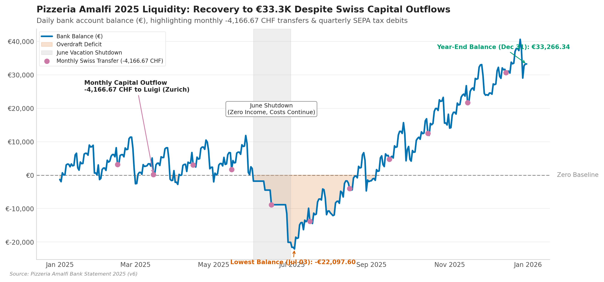

# Autonomous CFO — "Pany" Team

**An AI CFO for small business owners who don't have one.**
Built for the Commerzbank Collabothon 2026, Red Hat challenge.

The assistant watches the business bank account and the news, forecasts liquidity, and proposes next steps
in plain language: put spare cash into a deposit, or arrange a credit line before a cash gap.
**Nothing happens without the owner's approval, and every execution is simulated.**

Demo company: **Pizzeria Amalfi** (Frankfurt), with its full 2025 bank statement.



---

## What it does

| Page | What the owner sees |
|---|---|
| **Cashflow** | Balance history for 2025 and a 30/60/90-day forecast: the expected balance plus a likely range from 4,000 simulated futures |
| **Proposals** | Explained proposals (fixed-term deposits, credit line) with *What we see / What we suggest / Why this amount / On approval*, and an **Approve** button |
| **Business news** | Articles the news agent judged relevant to the business, with the reason why |
| **Chat** | An assistant that answers using the real forecast, the approved actions and the news. It is also available on every page as a floating widget that knows what is on screen |

Every proposal states its `analysis`, `recommendation`, `rationale`, `requires_approval` and
`execution_mode: simulated`. All numbers come from Python code. The LLM explains and drafts, and never makes up figures.

## Architecture

```
                         ┌──────────────────────────┐
  Bank statement (CSV) ─►│ Forecast service  :8081  │  statement → scheduled payments → 4,000 simulated
                         │ account-prediction/      │  futures → daily bands + "safe to lock" for 30/60/90 d
                         └────────────┬─────────────┘
                                      │
  ┌──────────────┐       ┌────────────▼─────────────┐       ┌──────────────────────────────┐
  │ Frontend     │──────►│ Backend (gateway) :8000  │──────►│ Instrument agent  :8082      │
  │ SvelteKit    │       │ backend/                 │       │ instrument_recommendation_   │
  │ :5173        │       │ · forecast / proposals   │       │ agent/ (LangChain + LLM)     │
  └──────┬───────┘       │ · approvals → simulated  │       └──────────────────────────────┘
         │               │   transaction + outbox   │
         │               │ · chat (LLM + live data) │──────►┌──────────────────────────────┐
         │               │ · SQLite (PVC)           │       │ News service      :8083      │
         └──────────────►└────────────┬─────────────┘       │ news/ (RSS + LLM triage)     │
           /news page                 │                     └──────────────────────────────┘
                                      ▼
                         LLM on OpenShift AI (vLLM, Qwen3-8B, OpenAI-compatible API)
```

| Component | Folder | Role |
|---|---|---|
| Frontend | [`frontend/`](frontend/) | SvelteKit (Svelte 5) UI. The browser only talks to SvelteKit server routes, which call the backend |
| Backend | [`backend/`](backend/) | FastAPI gateway: forecast, proposals, approvals, notification outbox, chat with history |
| Forecast service | [`account-prediction/`](account-prediction/) | Liquidity forecast and safe-to-lock amounts; turns news into forecast events |
| Instrument agent | [`instrument_recommendation_agent/`](instrument_recommendation_agent/) | Matches demo deposit offers to the forecast and drafts a notification e-mail |
| News service | [`news/`](news/) | Fetches RSS feeds, filters by keywords, lets the LLM judge relevance and duplicates |
| Notifications | [`backend/app/notifications/`](backend/app/notifications/) | In-app outbox; e-mail over SMTP when configured |
| Deployment | [`deploy/`](deploy/) | OpenShift AI: Qwen3-8B on vLLM, MLflow, NeMo Guardrails |

---

## Run everything locally

### 1. Prerequisites

- Python 3.11 or newer (`py` launcher on Windows)
- Node.js 20 or newer
- Access to the LLM endpoint on OpenShift AI: the URL and a service-account token from the RHOAI dashboard

### 2. Configure the LLM (once)

```powershell
copy backend\.env.example backend\.env
```

Fill in `LLM_BASE_URL` (the model's external route, ending in `/v1`) and `LLM_API_KEY`.
Leave `LLM_MODEL` empty to use the first served model. `backend/.env` is git-ignored, so never commit it.

### 3. Install dependencies (once)

```powershell
# Python services: one virtualenv each
foreach ($service in 'backend', 'account-prediction', 'instrument_recommendation_agent', 'news') {
  Push-Location $service
  py -3 -m venv .venv
  if ($service -eq 'backend') { .venv\Scripts\python -m pip install -e . pytest ruff }
  else { .venv\Scripts\python -m pip install -r requirements.txt }
  Pop-Location
}

# Frontend
cd frontend; npm ci; cd ..
```

### 4. Start

```powershell
powershell -ExecutionPolicy Bypass -File scripts\start-local.ps1
```

The script opens one window per service. It passes the LLM settings from `backend/.env` to each service
under the variable names that service expects, and wires all the URLs together:

| Service | URL |
|---|---|
| **App (open this)** | **http://localhost:5173** |
| Backend API docs | http://127.0.0.1:8000/docs |
| Forecast service docs | http://127.0.0.1:8081/docs |
| Instrument agent docs | http://127.0.0.1:8082/docs |
| News service docs | http://127.0.0.1:8083/docs |

To stop everything, close the windows.

**Sign in** on the landing page with the demo account: username `amalfi`, password `amalfi` (Pizzeria Amalfi).
Each account sees only its own data. To add a business, see the comment at the top of
[`frontend/src/lib/server/accounts.ts`](frontend/src/lib/server/accounts.ts): the same account id is needed
there, in [`backend/app/accounts.py`](backend/app/accounts.py) and in the forecast service's data.

<details>
<summary>Starting services by hand (macOS / Linux / Git Bash)</summary>

Run each block in its own terminal. Take `LLM_BASE_URL`, `LLM_API_KEY` and the model id from `backend/.env`
(`curl -H "Authorization: Bearer $LLM_API_KEY" $LLM_BASE_URL/models`).
On Windows, use `.venv/Scripts/python` instead of `.venv/bin/python`.

```bash
# Forecast service
cd account-prediction && LLM_BASE_URL=... LLM_API_KEY=... LLM_MODEL=... \
  .venv/bin/python -m uvicorn app.main:app --host 127.0.0.1 --port 8081

# Instrument agent (note: started from inside app/)
cd instrument_recommendation_agent/app && MODEL_BASE_URL=... MODEL_TOKEN=... MODEL_ID=... \
  ../.venv/bin/python -m uvicorn app:app --host 127.0.0.1 --port 8082

# News service
cd news && MODEL_URL=... TOKEN=... MODEL_NAME=... DB_PATH=news.db ADMIN_TOKEN=change-me \
  .venv/bin/python -m uvicorn app:app --host 127.0.0.1 --port 8083

# Backend
cd backend && FORECAST_API_URL=http://127.0.0.1:8081 INSTRUMENT_API_URL=http://127.0.0.1:8082 \
  NEWS_API_URL=http://127.0.0.1:8083 .venv/bin/python -m uvicorn app.main:app --host 127.0.0.1 --port 8000

# Frontend
cd frontend && CHAT_API_URL=http://127.0.0.1:8000 NEWS_API_URL=http://127.0.0.1:8083 npm run dev
```
</details>

### 5. Load news (optional)

The news service starts without feeds. Add RSS sources and fetch once, using the admin token that
`start-local.ps1` prints:

```powershell
$token = '<admin token from the script output>'
Invoke-RestMethod -Method Put -Uri http://127.0.0.1:8083/sources -Headers @{ 'X-Admin-Token' = $token } `
  -ContentType 'application/json' -Body '{"sources": [{"url": "https://<feed-url>", "name": "<source name>"}]}'
Invoke-RestMethod -Method Post -Uri http://127.0.0.1:8083/fetch -Headers @{ 'X-Admin-Token' = $token }
```

Feeds must use HTTPS. The keyword list in [`news/app.py`](news/app.py) decides which articles go to the LLM.

### Troubleshooting

| Symptom | Cause and fix |
|---|---|
| "The forecast service is not reachable right now" | The forecast service is not running, or `FORECAST_API_URL` is wrong. Check http://127.0.0.1:8081/health |
| "The news service has not been connected" | The frontend was started without `NEWS_API_URL` |
| Pages are slow on Windows | Use `127.0.0.1`, not `localhost`, in service URLs. On Windows `localhost` tries IPv6 first and adds about 2 s to every call |
| Proposals take ~10 s the first time | Expected: the instrument agent asks the LLM to draft its e-mail. The result is then cached for 15 minutes |
| LLM errors (401 / TLS) | Check `LLM_API_KEY`. For the cluster-internal endpoint, set `LLM_CA_BUNDLE`. Use `LLM_VERIFY_TLS=false` only in local dev |

---

## Configuration

All settings are environment variables. In local dev the backend also reads `backend/.env`.
The full list with comments is in [`backend/.env.example`](backend/.env.example).

| Variable | Used by | Meaning |
|---|---|---|
| `LLM_BASE_URL`, `LLM_API_KEY`, `LLM_MODEL` | backend, forecast service | OpenAI-compatible vLLM endpoint on OpenShift AI |
| `MODEL_BASE_URL`, `MODEL_TOKEN`, `MODEL_ID` | instrument agent | Same LLM, under that service's own names |
| `MODEL_URL`, `TOKEN`, `MODEL_NAME`, `ADMIN_TOKEN`, `DB_PATH` | news service | LLM plus the admin token for `/sources` and `/fetch` |
| `FORECAST_API_URL`, `INSTRUMENT_API_URL`, `NEWS_API_URL` | backend | Where the team services live. Empty means not connected, and the UI shows a friendly message |
| `DATABASE_PATH` | backend | SQLite file for chat history, decisions and the outbox (mount a PVC in the cluster) |
| `OWNER_EMAIL`, `SMTP_HOST`, `SMTP_PORT`, `SMTP_USER`, `SMTP_PASSWORD` | backend | Optional e-mail delivery of approval confirmations |
| `CHAT_API_URL`, `NEWS_API_URL` | frontend | Backend and news service base URLs |
| `SESSION_SECRET` | frontend | Signs the login cookie. Set it in the cluster; without it, everyone is signed out when the frontend restarts |

## Backend API

Every `/api` call needs the `X-Account-Id` header. The frontend server sets it after login; the browser never
calls the backend directly, so keep the backend Service cluster-internal (no Route).

| Endpoint | Purpose |
|---|---|
| `GET /api/forecast?horizon=90` | Forecast with daily bands, buffer and safe-to-lock amounts |
| `GET /api/proposals` | Current proposals and their status (`awaiting_approval`, `approved`, `declined`, `superseded`) |
| `POST /api/proposals/{id}/decision` | `{"decision": "approved" \| "declined"}`. Approval records a simulated transaction and a notification |
| `GET /api/transactions` | Simulated transactions |
| `GET /api/notifications` | Notification outbox |
| `GET/POST /api/news/impacts`, `DELETE /api/news/impacts/{article_id}` | News applied to the forecast and the events derived from them |
| `POST /api/chat`, `GET/DELETE /api/conversations[/{id}]` | Chat and its history |

## Development

```powershell
# Backend
cd backend; .venv\Scripts\python -m pytest -q; .venv\Scripts\python -m ruff check .

# Forecast service
cd account-prediction; .venv\Scripts\python -m pip install -r requirements-dev.txt; .venv\Scripts\python -m pytest -q

# Frontend
cd frontend; npm run check; npm run build
```

Coding conventions, the data format of the bank statement and the agent design rules are in [`CLAUDE.md`](CLAUDE.md).

## Deployment on OpenShift AI

The cluster runs Qwen3-8B on vLLM, MLflow and NeMo Guardrails. See [`deploy/`](deploy/):
- [`deploy/models/`](deploy/models/): the model InferenceService
- [`deploy/mlflow/`](deploy/mlflow/): experiment tracking and agent tracing
- [`deploy/guardrails/`](deploy/guardrails/): input guardrails
- [`deploy/integration-next-steps.md`](deploy/integration-next-steps.md): open integration work

Each service has a Dockerfile or can be deployed with `oc new-app`. The forecast service's
[README](account-prediction/README.md) shows the full `oc` flow.

## Data

[`data/raw/`](data/raw/) holds the Pizzeria Amalfi 2025 statement: AI-generated sample data provided by Commerzbank.
It is read-only. The story in the data: a June shutdown leads to an overdraft of about −€22,098 in early July,
followed by a Q3–Q4 recovery to €33,266 at year end and a recurring CHF transfer to Zurich.

---

*All offers, rates and executions in this app are illustrative and simulated. Nothing touches a real bank account.*
