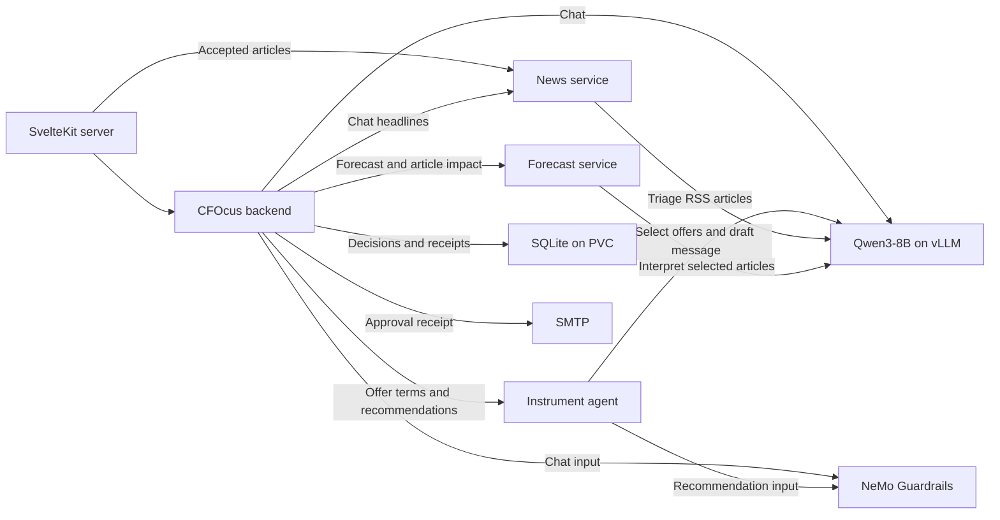

# CFOcus — "Pany" Team

**CFOcus: an AI CFO for small business owners who don't have one.**
Built for the Commerzbank Collabothon 2026, Red Hat challenge "Autonomous CFO".

CFOcus watches the business bank account and the news, forecasts liquidity, and proposes next steps
in plain language: put spare cash into a deposit, or arrange a credit line before a cash gap.
**The owner must approve each financial action. Every transaction is simulated.**

Demo company: **Pizzeria Amalfi** (Frankfurt), with its full 2025 bank statement.

## Live demo

| Open | Access |
|---|---|
| [CFOcus application](https://autonomous-cfo-cfo-ai.apps.ocp.k8wkr.sandbox735.opentlc.com/) | Choose **Log in**. Demo username and password are both `amalfi`. |
| [MLflow · agent traces and evaluations](https://rh-ai.apps.ocp.k8wkr.sandbox735.opentlc.com/mlflow/#/experiments/2?workspace=cfo-ai) | Sign in with an authorized OpenShift account. Select workspace `cfo-ai` and experiment `autonomous-cfo-agents`. |


---

## What it does

| Page | What the owner sees |
|---|---|
| **Overview** | 2025 balance history and a 90-day forecast. View the next 30, 60 or 90 days on the chart. The line is the median and the band spans the 5th to 95th percentiles of 4,000 simulations. |
| **Proposals** | Compare eligible products and terms, see why the amount fits, and review a credit line if the forecast shows a shortfall. **Approve** opens a confirmation. **Confirm approval** records the simulated transaction and adds a receipt to Notifications. |
| **Business news** | Browse accepted articles and the reason for each selection. **Check impact on my forecast** asks the forecast service to extract cash-flow events for this account. An article can yield no events. |
| **Chat** | Ask about the forecast, approved actions and news. Chat has its own page and a floating widget on the other signed-in pages. |

Each proposal includes `analysis`, `recommendation`, `rationale`, `requires_approval` and `execution_mode: simulated`.
Overview can show the effect of news estimates alongside confirmed changes. Investment proposals use the forecast with confirmed changes. The forecast service calculates balances and safe-to-lock amounts for the available terms.

The instrument agent selects eligible offers and drafts the message shown under **Message drafted by CFOcus**. After approval the backend prepares the receipt and sends it by e-mail when SMTP is configured.

## Architecture



| Component | Folder | Role |
|---|---|---|
| Frontend | [`frontend/`](frontend/) | SvelteKit (Svelte 5) UI. The browser only talks to SvelteKit server routes, which call the backend and read accepted articles from the news service |
| Backend | [`backend/`](backend/) | FastAPI gateway: forecast, proposals, approvals, notification outbox, chat with history |
| Forecast service | [`account-prediction/`](account-prediction/) | Liquidity forecast and safe-to-lock amounts; turns news into forecast events |
| Instrument agent | [`instrument_recommendation_agent/`](instrument_recommendation_agent/) | Selects product families and terms from the eligible demo offers and drafts an in-app message |
| News service | [`news/`](news/) | Fetches RSS feeds, filters by keywords, lets the LLM judge relevance and duplicates |
| Notifications | [`backend/app/notifications/`](backend/app/notifications/) | In-app outbox; e-mail over SMTP when configured |
| Deployment | [`deploy/`](deploy/) | OpenShift AI: Qwen3-8B on vLLM, MLflow, NeMo Guardrails |

---

## Run everything locally

### 1. Prerequisites

- Python 3.13 for the local setup below (`py` launcher on Windows). The forecast service image uses Python 3.12.
- Node.js 24.11.1 and npm, matching the frontend image
- Access to the LLM endpoint on OpenShift AI: the URL and a service-account token from the RHOAI dashboard

### 2. Configure the LLM (once)

```powershell
copy backend\.env.example backend\.env
```

Fill in `LLM_BASE_URL` (the model's external route, ending in `/v1`) and `LLM_API_KEY`.
Leave `LLM_MODEL` empty to use the first served model. `backend/.env` is git-ignored, so never commit it.

### 3. Install dependencies (once)

```powershell
# Python services: one virtualenv each
foreach ($service in 'backend', 'account-prediction', 'instrument_recommendation_agent', 'news') {
  Push-Location $service
  py -3.13 -m venv .venv
  if ($service -eq 'backend') { .venv\Scripts\python -m pip install -e . pytest ruff }
  else { .venv\Scripts\python -m pip install -r requirements.txt }
  Pop-Location
}

# Frontend
cd frontend; npm ci; cd ..
```

### 4. Start

```powershell
powershell -ExecutionPolicy Bypass -File scripts\start-local.ps1
```

The script opens one window per service. It passes the LLM settings from `backend/.env` to each service
under the variable names that service expects, and wires all the URLs together:

| Service | URL |
|---|---|
| **App (open this)** | **http://localhost:5173** |
| Backend API docs | http://127.0.0.1:8000/docs |
| Forecast service docs | http://127.0.0.1:8081/docs |
| Instrument agent docs | http://127.0.0.1:8082/docs |
| News service docs | http://127.0.0.1:8083/docs |

To stop everything, close the windows.

**Sign in** on the landing page with the demo account: username `amalfi`, password `amalfi` (Pizzeria Amalfi).
People who sign in as `amalfi` share the same demo decisions, chat history and saved news impacts. The article feed is shared across accounts. To add a business, see the comment at the top of
[`frontend/src/lib/server/accounts.ts`](frontend/src/lib/server/accounts.ts): the same account id is needed
there, in [`backend/app/accounts.py`](backend/app/accounts.py) and in the forecast service's data.

<details>
<summary>Starting services by hand (macOS / Linux / Git Bash)</summary>

Run each block in its own terminal. Take `LLM_BASE_URL`, `LLM_API_KEY` and the model id from `backend/.env`
(`curl -H "Authorization: Bearer $LLM_API_KEY" $LLM_BASE_URL/models`).
On Windows, use `.venv/Scripts/python` instead of `.venv/bin/python`.

```bash
# Forecast service
cd account-prediction && LLM_BASE_URL=... LLM_API_KEY=... LLM_MODEL=... \
  .venv/bin/python -m uvicorn app.main:app --host 127.0.0.1 --port 8081

# Instrument agent (note: started from inside app/)
cd instrument_recommendation_agent/app && MODEL_BASE_URL=... MODEL_TOKEN=... MODEL_ID=... \
  ../.venv/bin/python -m uvicorn app:app --host 127.0.0.1 --port 8082

# News service
cd news && MODEL_URL=... TOKEN=... MODEL_NAME=... DB_PATH=news.db ADMIN_TOKEN=change-me \
  .venv/bin/python -m uvicorn app:app --host 127.0.0.1 --port 8083

# Backend
cd backend && FORECAST_API_URL=http://127.0.0.1:8081 INSTRUMENT_API_URL=http://127.0.0.1:8082 \
  NEWS_API_URL=http://127.0.0.1:8083 .venv/bin/python -m uvicorn app.main:app --host 127.0.0.1 --port 8000

# Frontend
cd frontend && CHAT_API_URL=http://127.0.0.1:8000 NEWS_API_URL=http://127.0.0.1:8083 npm run dev
```
</details>

### 5. Load news (optional)

A fresh local news database has no feeds. `PUT /sources` replaces the complete source list. To populate it, supply your HTTPS feed URLs and use the admin token printed by `start-local.ps1`.

```powershell
$token = '<admin token from the script output>'
Invoke-RestMethod -Method Put -Uri http://127.0.0.1:8083/sources -Headers @{ 'X-Admin-Token' = $token } `
  -ContentType 'application/json' -Body '{"sources": [{"url": "https://<feed-url>", "name": "<source name>"}]}'
Invoke-RestMethod -Method Post -Uri http://127.0.0.1:8083/fetch -Headers @{ 'X-Admin-Token' = $token }
```

Feeds must use HTTPS. The keyword list in [`news/app.py`](news/app.py) decides which articles go to the LLM.

### Troubleshooting

| Symptom | Cause and fix |
|---|---|
| "The forecast service is not reachable right now" | The forecast service is not running, or `FORECAST_API_URL` is wrong. Check http://127.0.0.1:8081/health |
| "The news service has not been connected" | The frontend was started without `NEWS_API_URL` |
| Pages are slow on Windows | If services listen on IPv4, use `127.0.0.1` in the service URLs shown above. |
| The first visit to Proposals is slow | The instrument agent calls the LLM. The backend reuses successful recommendations for up to 15 minutes for the same account and forecast. |
| LLM errors (401 / TLS) | Check `LLM_API_KEY`. For the cluster-internal endpoint, set `LLM_CA_BUNDLE`. Use `LLM_VERIFY_TLS=false` only in local dev |

---

## Configuration

For local backend settings, copy [`backend/.env.example`](backend/.env.example). On OpenShift, the backend and instrument agent both read the `cfo-backend` ConfigMap. The backend also reads the optional `smtp-settings` Secret. The deployed settings are in the [backend manifest](deploy/cfo/backend.yaml).

| Variable | Used by | Meaning |
|---|---|---|
| `LLM_BASE_URL`, `LLM_API_KEY`, `LLM_MODEL` | local backend and forecast service | OpenAI-compatible endpoint, credential and model ID. The forecaster uses the LLM to interpret news. |
| `MODEL_BASE_URL`, `MODEL_TOKEN`, `MODEL_ID` | local instrument agent | Model endpoint, credential and served model ID used by `start-local.ps1` |
| `LLM_BASE_URL`, `LLM_MODEL`, `SERVICE_TOKEN_FILE`, `LLM_CA_BUNDLE` | backend and instrument agent on OpenShift | Qwen endpoint and model ID, mounted service-account token and trusted service CA |
| `GUARDRAILS_URL`, `MLFLOW_TRACKING_URI`, `MLFLOW_TRACKING_AUTH`, `MLFLOW_EXPERIMENT_NAME` | backend and instrument agent on OpenShift | NeMo input checks and MLflow tracing in the configured experiment |
| `MODEL_URL`, `TOKEN`, `MODEL_NAME`, `ADMIN_TOKEN`, `DB_PATH` | news service | LLM plus the admin token for `/sources` and `/fetch` |
| `FORECAST_API_URL`, `INSTRUMENT_API_URL`, `NEWS_API_URL` | backend | Where the team services live. Empty means not connected, and the UI shows a friendly message |
| `DATABASE_PATH` | backend | SQLite file for chat history, decisions and the outbox (mount a PVC in the cluster) |
| `OWNER_EMAIL`, `APPROVAL_COPY_EMAIL`, `SMTP_HOST`, `SMTP_PORT`, `SMTP_USER`, `SMTP_PASSWORD` | backend | Approval confirmations by SMTP with an optional blind copy |
| `CHAT_API_URL`, `NEWS_API_URL` | frontend | Backend and news service base URLs |
| `SESSION_SECRET` | frontend | Signs the login cookie. Set it in the cluster; without it, everyone is signed out when the frontend restarts |

## Backend API

Every `/api` call needs the `X-Account-Id` header. The frontend server sets it after login; the browser never
calls the backend directly, so keep the backend Service cluster-internal (no Route).

| Endpoint | Purpose |
|---|---|
| `GET /api/forecast?horizon=90` | Forecast with daily bands, buffer and safe-to-lock amounts |
| `GET /api/proposals` | Current proposals and their status (`awaiting_approval`, `approved`, `declined`, `superseded`) |
| `POST /api/proposals/{proposal_id}/decision` | `{"decision": "approved" \| "declined"}`. Approval records a simulated transaction and a notification |
| `GET /api/transactions` | Simulated transactions |
| `GET /api/notifications` | Notification outbox |
| `GET /api/news/impacts`, `POST /api/news/impacts`, `DELETE /api/news/impacts/{article_id}` | News applied to the forecast and the events derived from them |
| `POST /api/chat` | Send a chat message |
| `GET /api/conversations` | List this account’s conversations |
| `GET /api/conversations/{conversation_id}`, `DELETE /api/conversations/{conversation_id}` | Read or delete one conversation |

## Development

Run from the repository root in PowerShell.

```powershell
Push-Location backend
.\.venv\Scripts\python -m pytest -q
.\.venv\Scripts\python -m ruff check .
Pop-Location

Push-Location account-prediction
.\.venv\Scripts\python -m pip install -r requirements-dev.txt
.\.venv\Scripts\python -m pytest -q
Pop-Location

Push-Location frontend
npm run check
npm run build
Pop-Location
```

Coding conventions, the data format of the bank statement and the agent design rules are in [`CLAUDE.md`](CLAUDE.md).

## Deployment on OpenShift AI

The `cfo-ai` project runs the frontend, backend and instrument agent. In `sth`, `forecaster` serves forecasts and interprets selected articles, and `news-service` serves the accepted feed. Both services have their own model settings and currently point to the external Qwen3-8B route. The five application Services expose port `8080` inside the cluster.

The backend and instrument agent use the internal model endpoint. They check their inputs with NeMo Guardrails and call Qwen3-8B, served by vLLM on one NVIDIA L4 in `my-first-model`. Both emit MLflow traces. The acceptance script logs evaluation results in the same experiment. [Open the recorded acceptance run](https://rh-ai.apps.ocp.k8wkr.sandbox735.opentlc.com/mlflow/#/experiments/2/runs/fbe15f2c7deb4bf19e84b6f3f5d2ba92?workspace=cfo-ai).

For builds, deployment and the demo approval reset on Windows or macOS, use the [OpenShift deployment guide](deploy/cfo/README.md).

Component documentation: [Qwen on vLLM](deploy/models/), [NeMo Guardrails](deploy/guardrails/), [MLflow](deploy/mlflow/) and the [forecast service](account-prediction/README.md).

## Data

[`data/raw/`](data/raw/) holds the Pizzeria Amalfi 2025 statement: AI-generated sample data provided by Commerzbank.
It is read-only. The story in the data: a June shutdown leads to an overdraft of about −€22,098 in early July,
followed by a Q3–Q4 recovery and a recurring CHF transfer to Zurich. The dashboard statement closes at €33,266.34. The [forecast profile](account-prediction/data/accounts/amalfi/profile.json) supplies a starting balance of €33,266.35.

---

*All offers, rates and executions in this app are illustrative and simulated. Nothing touches a real bank account.*
